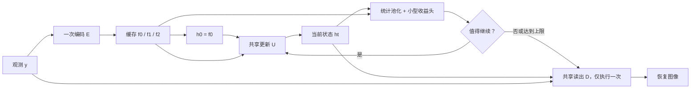

# 可复用迭代恢复：架构与训练设计

设计日期：2026-10-21。对应 `research_problem_and_related_work.md` 的 RQ1–RQ4，数据和指标沿用 `datasets_and_evaluation.md`。本文区分设计建议、可运行结构探针与训练后才能判断的研究结论。

实现更新（2026-10-23）：基础模型模块、HF/本地数据准备、恢复主干训练、断点续训和固定出口评估已接入，见 `README.md`。新框架先采用 DIV2K HR 的独立工程划分；收益头训练与动态策略校准仍未实现。第 9 节保留 2026-10-21 历史结构探针记录。

## 1. 推荐方案与理由

**先实现“缓存观测金字塔 + 共享 NAF 风格 U-Net 更新 + 持久潜状态 + 多跨度收益头”。** 第一次更新就输出完整恢复图；之后复用同一个更新单元。停止头直接读取已计算的潜特征，仅在最终退出时重建图像。

这套设计首先检验三个假设：共享更新是否能兼顾第一出口和后续收益；收益差异是否存在于相同噪声等级内部；省掉的更新是否足以覆盖池化、决策与同步开销。它是研究起点，目前不能作为已经成立的方法贡献。

首轮不引入 diffusion、Transformer 主干、MoE、patch 路由或联合强化学习。NAF 风格模块提供便于控制容量的恢复基本单元；选择它是为了验证计算分配机制。NAFNet 原论文和官方实现是模块依据，不能将此处的循环结构称为官方 NAFNet。[NAFNet 论文](https://arxiv.org/abs/2204.04676)、[官方代码](https://github.com/megvii-research/NAFNet/blob/main/basicsr/models/archs/NAFNet_arch.py)

## 2. 总体计算图



训练与离线分析时重建每个出口；固定预算和在线停止时均只重建最终出口。这样可以直接比较决策收益，不需要让动态策略承担额外的中间图像解码。若后续加入图像残差反馈，就要重新计入所有中间读出成本。

### 2.1 状态和共享范围

对已统一预处理的 RGB 输入，内部记尺寸为 H×W：

\[
f_0=C_{3\times3}^{3\to C}(y),\quad
f_1=C_{2\times2,s=2}^{C\to2C}(f_0),\quad
f_2=C_{2\times2,s=2}^{2C\to4C}(f_1),\quad h_0=f_0.
\]

\[
h_{t+1}=h_t+\alpha R_\theta(h_t;f_0,f_1,f_2),\qquad
\hat x_t=y+D_\theta(h_t),\qquad \alpha=\operatorname{sigmoid}(a).
\]

推荐 α 初值 0.1，D 为 C→3 的 3×3 卷积。R、D 与 α 在所有步骤之间共享；没有每步专属解码器或步数嵌入。σ 和真实任务标签不输入模型。α 约束更新幅度，但**不能证明整个迭代收敛或输出质量单调**。

持久状态先只保留全分辨率 h；R 内部的多尺度特征每次重算。缓存 f 代表静态观测，多尺度临时特征代表本轮计算，两者应在代码和论文里分清。若后续每轮重新执行完整观测编码器，就失去这项缓存设计。

### 2.2 共享更新单元

| 部分 | 运算 | 输出尺寸，C=24 |
|---|---|---|
| 全尺寸入口 | b0 = N0(h + f0) | 24×H×W |
| 下采样 1 | b1 = N1(Down0(b0) + f1) | 48×H/2×W/2 |
| 下采样 2 | b2 = N2(Down1(b1) + f2) | 96×H/4×W/4 |
| 上采样 1 | u1 = N3(Up1(b2) + b1) | 48×H/2×W/2 |
| 上采样 2 | u0 = N4(Up0(u1) + b0) | 24×H×W |
| 潜状态修正 | R = Conv3×3(u0) | 24×H×W |

Down 使用 2×2 stride-2 卷积；Up 使用 1×1 卷积加 PixelShuffle(2)。N0…N4 的 NAF 风格 block 数为 **[1,1,2,1,1]**，不同空间位置的组有各自参数，但同一组跨迭代共享。C=32 是单独的容量对照，不作为默认扩大规模的理由。

每个 block 采用逐像素通道 LayerNorm、1×1 扩展、3×3 depthwise convolution、SimpleGate、简化通道注意力，以及带 SimpleGate 的前馈分支。内部残差缩放 β、γ 按 NAFNet 方式从零初始化；外层 α 保持非零，修正和读出卷积不要同时全部零初始化。标准 PyTorch 实现优先，首轮不依赖自定义 CUDA 扩展。[官方 NAFBlock](https://github.com/megvii-research/NAFNet/blob/main/basicsr/models/archs/NAFNet_arch.py)

该设计仍会重复计算 R 中的降采样与上采样；“复用状态”不等于所有中间激活都只计算一次。更激进的多尺度持久状态能减少部分重算，但会改变更新规则和显存占用，放到后续消融。

### 2.3 第一出口质量不足时的修改顺序

首先比较同结构的一步独立模型和四步共享模型的第一出口，区分容量不足与多预算训练冲突。若独立一步也弱，适度增加 block 或宽度；若只有共享模型的第一出口弱，先调整深监督权重或初始化训练。

仍无改善时，比较“较强的一次性初始化器 + 较小共享修正尾部”：初始化器先产生可用结果，后续迭代专门学习小修正。重新定义出口和成本，避免把初始化计算隐藏在第零步。这是明确的结构备选，需要重新测量短预算曲线，不能假定一定优于对称更新。

## 3. 停止头：预测后续收益，而非当前质量

### 3.1 默认输入

对每个已完成的 t，使用：

\[
z_t=[\operatorname{GAP}(h_t),\operatorname{RMS}(h_t),
\operatorname{GAP}(f_0),\operatorname{GAP}(h_t)-\operatorname{GAP}(h_{t-1}),
\log H,\log W,t/4].
\]

GAP 和 RMS 均按通道对空间池化；缓存观测 GAP 只计算一次。维数为 4C+3，默认 MLP 为 (4C+3)→64→3，隐藏层用 GELU，末层保持线性。该头的非线性不受 NAFBlock 的结构选择约束。

这些统计不是免费操作：尤其全尺寸 RMS 需要额外读特征和规约。先保留可运行版本，再消融掉 RMS 或换为更新单元低分辨率特征。GAP 差不是完整特征差范数，不能据此声称已精确测量更新幅度。MLP 参数量很小也不代表主机同步成本很小。

### 3.2 多跨度、有符号标签

冻结恢复主干，在停止头训练集离线生成四步完整轨迹，计算：

\[
g_{t,k}=\operatorname{PSNR}(\operatorname{clip}(\hat x_{t+k}),x^*)-
\operatorname{PSNR}(\operatorname{clip}(\hat x_t),x^*),\quad 1\leq k\leq4-t.
\]

头输出 k=1/2/3 的预测，并对不存在的跨度使用 mask。保留负增益；最后一层不能用 ReLU 或 softplus。主干训练用未裁剪输出，标签按最终质量协议对输出 clip。指标以 FP32 计算。

默认对有效项使用 Huber 回归；按源图、σ、t 均衡抽取，避免重复裁块使某几张图占据训练。另报增益符号判断、相同 σ 内的排序和最终停止后的质量；单看回归 MAE 无法判断分配是否有效。

**为什么不只预测下一步？** 例如 q1=30.00、q2=29.99、q3=30.15 dB，一步非正就停会错过两步收益。因此，一步预测作为简化对照，多跨度预测作为默认研究方案。未来真实输出只在离线构造训练标签和诊断时使用，部署不得读取。

### 3.3 成本感知的滚动决策

在当前出口，令 Δc(t,k,H,W) 表示再执行 k 步的增量时间估计，则：

\[
A_t=\max_{1\leq k\leq T_{\max}-t}
\{\hat g_{t,k}-\lambda\,\Delta c(t,k,H,W)\}.
\]

当 A_t>0 时再执行一步并重新判断，否则退出；达到上限直接退出。λ 的单位是 dB/ms，在验证集为不同预算选择。它代表滚动规划启发式，**不是已经求得最优停止策略**；对多个预测取最大值可能放大预测误差，需要通过部署结果校准。

成本表来自目标 GPU、精度、尺寸和真实执行路径的测量。应包括后续更新与后续决策/同步开销；当前已经支付的决策成本属于沉没成本。所有路径最终相同的一次读出可以在增量比较中抵消，但完整延迟仍要包含它。完整方法至少每步回传一个判断标量，`.item()` 造成的同步要计时。

Δc 可先用少量尺寸桶做查表；不应在线跑计时器决定每张图多算几步。用验证集真正动态运行后的平均延迟选择 λ；不能用平均步数替代校准。调 λ 不保证任意离散预算都精确可达，也不自动满足逐图截止时间。

如果改为选定 k 后一次执行 k 步再检查，会减少检查频率，同时改变反馈时点；它应是单独策略，并重测成本表，不能与逐步重决策混写。

### 3.4 最优停止扩展的边界

若多跨度头效果有限，可比较以 λ 为输入的停止优势预测。但直接将“未来真实 PSNR 的最大净收益”当标签训练，只得到对完美未来诊断策略的模仿；它不等于基于当前信息的条件期望 Bellman 解。首轮不必增加这项复杂度，更不应以动态规划公式替代实际预算曲线证据。

## 4. 训练：先获得好轨迹，再学习分配

### 4.1 主干阶段

| 项目 | 首轮起点 |
|---|---|
| 数据 | BSD400 + WED，RGB；与既定文件一致 |
| 加噪 | 15/25/50 均衡；截断、uint8 量化，与主协议一致 |
| patch / microbatch | 128×128 / 1，先实测再增加 |
| 计算展开 | 4 步，完整反向传播，不 detach 中间状态 |
| 出口损失 | 1/2/3/4 步均监督，权重各 0.25 |
| 优化器起点 | AdamW，lr=2e-4，betas=(0.9,0.999)，weight_decay=0 |
| 数值与裁剪 | FP16 autocast + GradScaler；unscale 后 grad norm clip=1 |
| 学习率 | 短 warmup 后 cosine；长度以实际更新数固定 |

默认先用四个出口的平均 L1 重建损失，与固定模型保持一致：

\[
\mathcal L_{\mathrm{rec}}=\frac14\sum_{t=1}^4\|\hat x_t-x^*\|_1.
\]

先跑小数据检查，再用相同数据、优化器和损失训练一步独立模型及四步共享模型。第一轮可先给共享模型 20k 更新作诊断；这不是完整收敛预算，也不能据此报告最终基线优劣。根据真实迭代速度、验证曲线与独立基线收敛情况决定是否扩至 100k 或更长，记录 GPU 小时和总处理 patch 数。

不建议主干与停止头一开始联合训练：提前停止可能让晚期更新收不到足够训练；主干变化也会持续改变收益标签。冻结后训练头可以把“恢复轨迹问题”和“预算分配问题”分开定位。

显存不足先减 microbatch、做梯度累积；其次考虑按整个共享更新单元进行 activation checkpointing，记录额外训练时间。参数共享只减少权重和优化器状态，四步完整反向仍需保存多步激活。不能将迭代状态 detach 作为不影响目标的省显存技巧。

### 4.2 逐项启用的训练选项

1. 若短出口落后但后期收益存在，比较等权与 [0.4,0.3,0.2,0.1] 早出优先权重；同时观察第四出口是否被牺牲。
2. 若共享模型难训练，可先训练一步，再以同一参数初始化四步；独立基线须披露并匹配额外预训练预算。
3. 若轨迹频繁下降，再试小权重 MSE 单调正则：sum_t relu(MSE(x[t+1],x*)−MSE(x[t],x*))。它会限制中途下降后再提升的路径，可能消除多步收益，不能默认启用。
4. 不把修正幅度收缩或不动点一致性当成“继续计算有价值”的证据；它们也可能把所有后续更新压成零。

### 4.3 收益头阶段与阈值阶段

主干 checkpoint 在开发验证集选择后冻结。用 DIV2K HR 的 60 张角色生成含多个尺寸的训练轨迹；仅用训练等级 15/25/50。头可从 AdamW、lr=1e-3、小 batch 特征训练起步；直接缓存池化特征和标量标签即可，首轮无需保存所有全尺寸潜状态。

其余 40 张用于选择收益头 checkpoint 和预算阈值。35/75 不用于头训练、校准或恢复 checkpoint 选择。同源图所有裁块、σ 和噪声种子保持同一角色；图像数少，头的学习曲线和图像级重采样波动必须检查。

首轮部署上限为四步。6/8 步只测裸主干可靠性；四步标签训练出的收益头只有三个跨度输出，不能据此声称它支持八步自适应推理。若另训八步收益头，应明确它见过八步轨迹标签。

## 5. 必需对照与决策顺序

### 5.1 先检查是否有值得分配的计算

在同一冻结主干上记录每张图的 q1…q4 和完整固定步数延迟。画固定曲线、与输入无关的固定步数混合包络，再做相同总预算的参考图像辅助分配。按每个 σ 分开计算。

若参考辅助分配与固定混合之间几乎没有空间，应优先改恢复轨迹或停止此分配路线；再大的决策网络也不能创造给定轨迹里不存在的收益。诊断最好同时给出理想低开销成本模型和加入实际控制成本的模型，以判断这点空间是否足以支付控制开销。

### 5.2 同主干策略表

| 策略 | 可以读取 | 必须计入的额外计算 | 解决的问题 |
|---|---|---|---|
| 固定 1/2/3/4 步 | 配置 | 无停止头 | 共享轨迹本身的曲线 |
| 输入无关固定混合 | 请求编号的稳定随机数 | 混合调度 | 是否只是填补离散预算空隙 |
| 输入条件选步 | 缓存 f 的池化、尺寸 | 一次输入预算头 | 静态观测已足够选预算吗 |
| 简单状态阈值 | 潜状态更新统计 | 规约与同步 | 小 MLP 是否真有必要 |
| 一跨度收益头 | 当前/历史统计 | 每步头与同步 | 多跨度是否必要 |
| 多跨度收益头 | 相同统计 | 每步头与同步 | 继续收益预测的最终效果 |
| 参考辅助分配 | 全轨迹与干净图 | 单列诊断成本假设 | 给定主干和出口的可分配空间 |

输入条件基线应从相同缓存编码器得到特征，允许尺寸信息，训练目标和数据角色与状态头一致。不能故意只给它一个弱 σ 估计器，再把内容信息优势归因于当前状态。

外部固定模型至少包含在相同数据上重训的短、长两个 NAF 风格固定预算配置，按完整实测延迟配对；它们用于判定整个方法是否实用。一步独立同结构模型用于区分共享训练冲突，不能替代外部强固定基线。官方 SIDD 权重与当前合成噪声协议不同。[NAFNet 官方仓库](https://github.com/megvii-research/NAFNet)

### 5.3 结构消融优先级

| 优先级 | 对照 | 核心判断 |
|---|---|---|
| P0 | 一步独立 vs 四步共享、多出口等权 | 短预算问题是否来自参数共享/训练冲突 |
| P0 | 固定混合 vs 参考分配 vs 部署分配 | 收益空间、可预测性和控制开销分别在哪里 |
| P0 | 输入头 vs 状态头；一步 vs 多跨度 | 状态反馈和更长规划是否值得 |
| P1 | 缓存 f vs 每轮重新编码；h-only vs 图像反馈 | 特征复用省多少，图像反馈是否补偿成本 |
| P1 | C24 vs C32；等权 vs 早出优先 | 容量与预算权重的影响 |
| P2 | 单尺度持久 h vs 多尺度持久状态 | 是否值得增加状态复杂度 |
| P2 | 强初始化器+小修正尾部 | 对称共享单元是否限制首步表现 |

不同时修改多项再归因。三任务扩展前，至少完成 P0。另以“仅最终出口监督”作训练机制消融，确认多出口监督是否改善整条预算曲线。

## 6. 长展开和多任务扩展

α、NAF 的残差结构和静态观测锚点都有利于把更新做成渐进修正，但无法代替实验。固定训练四步后，对 6/8 步报告相对第四步的均值变化、第 5 百分位和下降超过 0.1 dB 的图像比例；同时看修正范数、状态范数和数值有限性。未下降和额外恢复收益是不同结论。

去噪机制成立后，沿用同一个编码器和共享更新扩展去噪/雨/雾，先只改数据采样。若任务间干扰明显，再加由 f2 池化预测的小型调制，对通道做轻量 scale/shift；条件只从输入估计，预算阈值不读取真实任务标签。雨雾需要更大感受野时，再比较第三尺度或更深 bottleneck，并重新匹配延迟。该扩展不预先保证三任务都能由去噪结构直接处理。

空间自适应和迭代自适应是不同控制维度。首轮整图 batch=1 提前退出；以后再讨论 patch 路由，必须计入切块、拼接、重叠边缘和调度成本。

## 7. 与已有工作的具体关系

DURR 已将共享循环恢复、当前恢复结果条件策略和损失下降奖励结合，并用 Q-learning 学习累计回报，因此不能把它描述成只看一步收益；2018 是预印本年份，正式发表为 ICLR 2019。“共享更新 + 收益停止”不能直接作为创新标题。这里更具体的可检验方向是：在不逐步生成图像的潜状态上预测多跨度保真收益，结合短预算训练和完整成本校准，能否在当前强基线之上带来净质量—延迟改善。模块替换与监督回归本身仍不足以证明新颖性。[DURR 正式版](https://web.stanford.edu/~yplu/pub/durriclr.pdf)

其他定位遵守原研究文档：AdaRevD 是多出口自适应恢复参照，RAR 是更新后质量验证/停止参照。多跨度收益头的提出不构成已穷尽文献的新颖性判定；需要依据实验瓶颈进一步收窄具体方法贡献。

跨轮潜特征传播也有 NLRN 等先例；阶段专属适配已有 LoRun 等研究。本设计不把潜状态本身视为新意，并暂不引入每步独有 LoRA，以保留任意次数共享展开的明确定义。详细的一手来源及实现边界见 `architecture_literature_notes.md`。[NLRN](https://arxiv.org/abs/1806.02919)、[LoRun](https://arxiv.org/abs/2602.18697)

## 8. 本机实现与测量边界

已检查的运行环境：`H:\anaconda3\envs\py312\python.exe`，Python 3.12.11、PyTorch 2.9.1+cu126、CUDA runtime 12.6、cuDNN 91002，RTX 4060 Laptop GPU，8 GiB。驱动报告支持 CUDA 13.1，与当前 PyTorch 使用的 runtime 12.6 是不同字段，不需要因此更换环境。

建议使用 `torch.amp.autocast("cuda", dtype=torch.float16)` 和 `torch.amp.GradScaler("cuda")`，先在 eager 模式把结果跑通。敏感规约与指标用 FP32。FP16 的实际收益取决于此结构、尺寸和算子，不预设一定加速。[PyTorch 2.9 AMP 文档](https://docs.pytorch.org/docs/2.9/amp.html)

首次比较应记录 TF32/FP32 设置、cuDNN benchmark、精度与内存格式，避免将不同数值模式混为 FP32。先不把 `torch.compile` 作为依赖；后续若加入，编译时间单列，所有策略用一致的优化条件，并保留真实主机分支的时间。

NAF 的全局通道池化也存在训练裁块与整图推理的统计差异；NAFNet 论文讨论了 TLC 处理。当前探针是普通全局池化版本。若后续转换为 TLC，应对所有出口采用同一规则，重新生成控制标签并计时，不能仅修改最后出口。停止头的多尺寸训练不能自动消除主干里的此类偏移。[NAFNet §5.1](https://arxiv.org/html/2204.04676v4)

输入已在 GPU、输出留在 GPU 为首轮计时边界；包括 E、真正执行的 U、最终 D、池化、头、主机读取和循环开销。每个完整请求计时前后同步 CUDA，使用 CPU wall-clock；动态路径真正停止，不执行剩余更新。CUDA 的异步执行需要这种边界处理。[PyTorch 2.9 CUDA 计时说明](https://docs.pytorch.org/docs/2.9/notes/cuda.html#asynchronous-execution)

原型支持内部 pad 到 4 的倍数并 crop 回输入尺寸，这是实现能力。正式主表仍先按数据方案中心裁到 16 的倍数；“支持原图”不意味着已改动评估协议。训练 patch 首选 128；全尺寸推理显存和延迟单独测，不能由 patch 训练显存直接推断。

## 9. 本轮交付与实验入口

- `prototypes/reusable_refiner.py`：共享主干、逐出口分析接口和真实动态停止接口。
- `prototypes/probe_architecture.py`：参数、显存、延迟和反向传播结构检查。
- `prototypes/probe_results.json`：本机未训练工程探针结果。

这些文件用于确认结构能运行和成本量级。2026-10-21 探针未下载数据、训练恢复 checkpoint 或收益头，因此没有 PSNR 有效性或自适应加速结论。2026-10-23 已在新框架补充 manifest、训练与固定出口评价入口，并完成合成图短程验证；真实数据训练、收益标签生成和策略校准仍需后续执行。

原型 `forward_dynamic` 的 `extra_cost_ms=(1,2,3)` 是 API 占位值，表示三个跨度的累计额外成本；它目前不按尺寸和当前步查表。正式部署前需接入实测 Δc(t,k,H,W)，特别区分末出口无需再判断的成本。±∞ 阈值仅用于强制首/末出口的结构检查，不能用于报告已学会的停止策略。

### 9.1 本机工程探针结果

随机初始化模型，batch=1，eager，NCHW 输入，关闭 cuDNN benchmark 和 TF32。每条路径预热 10 次、测量 10 次；顺序测量，未控制笔记本功耗、热状态和桌面负载。下表为 **512×512、AMP FP16、完整固定预算请求的平均 wall-clock**，不是经过训练的方法效果或正式速度基准。

| 宽度 | 总参数 / 收益头参数 | 1 步 | 2 步 | 4 步 | 8 步 | 4 步峰值 allocated |
|---|---|---|---|---|---|---|
| C24 | 262,967 / 6,595 | 20.92 ms | 41.13 ms | 82.05 ms | 163.00 ms | 220.66 MiB |
| C32 | 458,759 / 8,643 | 30.13 ms | 58.84 ms | 116.30 ms | 232.28 ms | 291.63 MiB |

同一轮 C24 的四步强制动态满步路径为 84.59 ms，固定四步为 82.05 ms；动态强制第一步退出为 22.08 ms。它们仅用于暴露控制路径的成本，头仍为随机参数，不能作为质量匹配下的节省结果，也不宜将两次短测相减作为精确模块开销。

独立组件诊断中，C24、512 尺寸的策略统计提取约 0.47 ms，MLP 约 0.16 ms，从已就绪状态开始的整段策略约 0.70 ms。可见全图统计比头本身更值得优化。各组件单独同步测量，不能相加重建完整请求时间；就绪标量的回读也不包含等待前序 GPU 工作的时间。

C24/C32 均通过输出形状、有限值、固定与离线轨迹一致、动态强制首/末出口一致、极小图 padding 检查。128×128、microbatch=1、四步 AMP 完整反向和一次 AdamW 更新均通过，峰值 allocated 分别约 **216.54 / 283.71 MiB**。这里只做合成梯度检查，使用 float 高斯噪声与 MSE，未执行正式的量化噪声/L1 训练协议；单次首更新耗时含初始化，不能用来估算整个训练周期。

allocated/reserved 均为此 Python 进程的 PyTorch CUDA 分配统计，不包含其他进程、桌面和全部驱动占用，不能当作整卡总显存。微批次 1 已验证，可依次实测 2/4/8 寻找更好的吞吐；正式训练按观察到的峰值留余量。

完整结果保留全部样本。256 尺寸首轮有启动/时钟波动，C32、512、FP32 动态满步出现大离群；不能将这些短测直接解释为模型效率差异。正式实验需按已有测评方案增加预热、交替方法顺序、多轮重复并报告尾部延迟。

PowerShell 中直接调用解释器，避免依赖 shell 的 conda 激活：

```powershell
& 'H:\anaconda3\envs\py312\python.exe' '.\prototypes\probe_architecture.py' --help

# 重跑默认探针会覆盖默认 JSON；指定新文件可保留本轮记录
& 'H:\anaconda3\envs\py312\python.exe' '.\prototypes\probe_architecture.py' --output '.\prototypes\probe_results_rerun.json'
```
